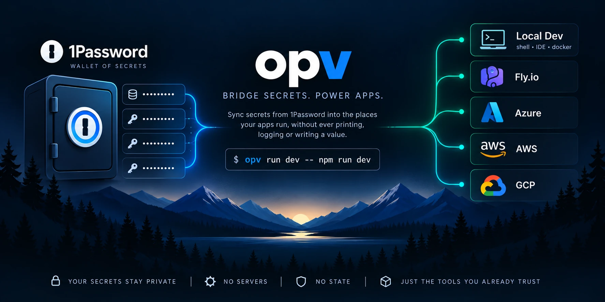
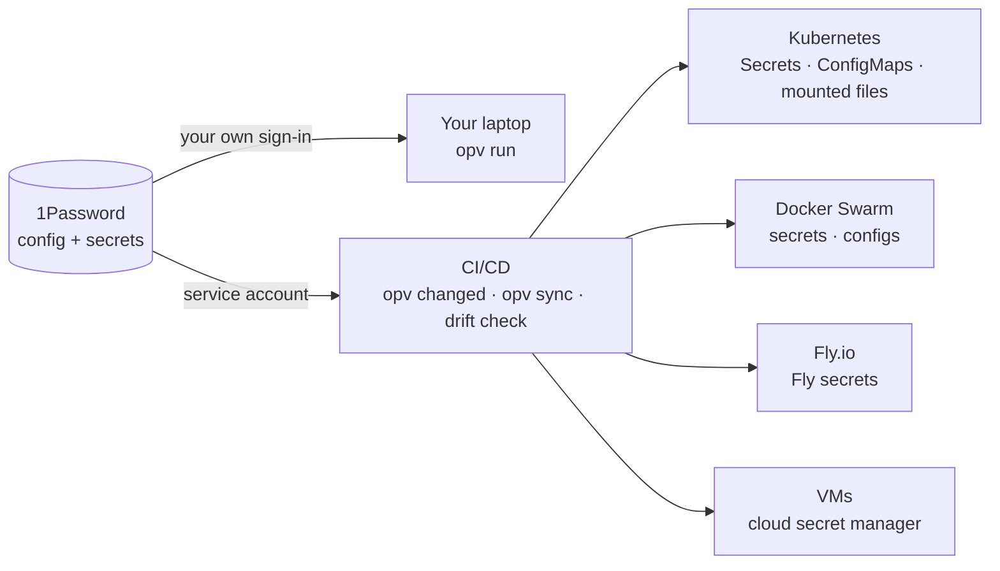

<p align="center">
  
</p>

# opv

[](https://github.com/matt-cochran/1password-vault/actions/workflows/ci.yml)
[](https://github.com/matt-cochran/1password-vault/releases/latest)
[](LICENSE)
[](Cargo.toml)

Deliver 1Password-managed secrets to application runtimes and CI, with validation and explicit deployment controls.

1Password owns the values. Your runtime consumes them. `opv` connects the two and nothing else: no server, no independent secrets store, no encryption of its own, and no command intended to print secret-kind values. Non-secret account selection and configuration may be recorded locally. What to sync is a small configuration of IDs, key names and validation rules, never values, kept in 1Password next to the secrets or in a committed `secrets.toml`.

## How opv works: one source of truth, synced by CI

1Password holds everything your app is configured with: its settings and its secrets. Nothing else does. opv moves those values to where they are needed and never anywhere else.



- **Local development:** `opv run dev -- <your command>` starts your app with the values it needs, as variables or as files in a private in-memory folder, and cleans up when it stops. Values never touch your disk.
- **CI/CD:** a workflow runs `opv sync` with a 1Password service account. opv writes secrets and settings into each platform's own place: Kubernetes Secrets and ConfigMaps, Swarm secrets, Fly secrets, a cloud secret manager.
- **Production never touches 1Password.** Your running app reads only what its platform gives it. There is no 1Password token, no opv, and no `op` in your images or servers.
- **Staying in step:** a scheduled job runs `opv changed`, which notices when someone edits a value in 1Password and triggers the sync. Production syncs wait for a reviewer to approve the exact plan. A nightly drift check fails if a platform no longer matches 1Password.

Copy the ready-made workflows: [examples/ci-change-detection](examples/ci-change-detection/).

## Quick start

Install with npm, on macOS, Linux, WSL or Windows ([other ways](docs/install.md)):

```sh
npm install -g @matthew-cochran/opv
```

npm picks the prebuilt binary for your system; the command is `opv`. Without Node.js, on Linux or macOS:

```sh
curl -fsSL https://raw.githubusercontent.com/matt-cochran/1password-vault/main/install.sh | sh
```

Working with an AI coding assistant (Claude Code, Codex, Cursor)? From 0.6.0, add its agent skill, so every new session starts from `opv guide agent`, `opv schema` and `opv ready --json` and never handles a secret value:

```sh
opv skill install --user          # or, with the script: ... | sh -s -- --skill
```

In a checkout of a project whose configuration lives in 1Password, no file is needed:

```sh
opv login dev                    # sign in to dev's 1Password account (your own terminal)
opv run dev -- npm run dev       # your app, with dev's settings as environment variables
```

opv finds the configuration by the repository's git remote, and `op run` resolves the values without creating a local secret-value file for this workflow.

A whole fleet from a fresh account (several products and environments, Fly and CI): [examples/fleet-fly](examples/fleet-fly/), driven by `opv bootstrap` and `opv ready`.

Starting from nothing: [install `op`](docs/install.md) (on macOS and Windows, also turn on **Settings > Developer > Integrate with 1Password CLI** in the 1Password app). Then, in your project:

```sh
opv login --account you@example.com            # adds the account to op if needed, signs in, remembers it for the project
opv init dev --product api                     # run-only: vault myapp-api-dev, item "myapp · api · dev values" (created if missing); configuration saved in 1Password
opv add api/API_KEY --kind secret --env dev
opv check dev                                  # adds the empty field; opv open api/API_KEY, click Edit, type the value
opv run dev -- npm run dev
```

Already have a `.env`? `opv init dev --from .env --apply` declares every key and imports the values, verified, in one step ([details](docs/configuration.md#start-from-an-existing-env-opv-init---from)). `opv init` can also start from an item you already have ([configuration](docs/configuration.md#start-from-an-existing-item-opv-init)), and `opv setup` walks a person through a project that ships a setup recipe ([guided setup](docs/guided-setup.md)).

Then, for a deployed environment:

```sh
opv status prod                  # one row per key, problems first
opv plan prod                    # what a sync would write, hold and prune, and its plan id
opv sync prod --deploy --expect-plan 412a5b23   # exactly that plan, then deploy
```

```console
$ opv status prod
prod/web: 2 keys · 0 saved · 0 skipped · 2 findings · 0 not yet on Fly
TARGET  PRODUCT  KEY             KIND    STATE                                             ON TARGET
web     api      LOG_LEVEL       config  failed enum (expected one of: debug, info, warn)  n/a
web     api      OPENAI_API_KEY  secret  missing                                           unknown
    guidance: OpenAI platform / API keys
unknown: Fly does not reveal stored values, so opv cannot compare them; sync stages them and compares digests (opv help states)
opv: 2 findings
Do: fix the keys above in 1Password (click Edit on the item: it hides empty fields until then)
Next: opv open api/LOG_LEVEL --env prod
```

Problems come first, each with its reason and a link to its item in 1Password, the only place a value is typed. Every failure ends with one runnable `Next:` command.

## Why

- **Reduce secret exposure.** Secret values are delivered through stdin, a protected Windows pipe, or a child process environment rather than command arguments or reporting output. Azure deploy credentials have a documented private credential-cache exception; see [security boundaries](docs/usage.md#security-model-and-limits).
- **Typed and checked before they ship.** Each key declares its kind (secret or config) and rules (`prefix`, `base64_bytes`, `enum`, `https_url`, ...). A bad value fails `status` with the key, the rule and a reason, never the value.
- **Explicit, never surprising.** No prompts in automation. Nothing is deployed without `--deploy`, nothing is deleted without `--prune`, and prune only touches names opv manages.
- **Safe to re-run.** Reads are retried, writes are checked, and an interrupted run converges when you run it again ([how opv handles failures](docs/how-opv-handles-failures.md)).
- **Built for scripts and assistants.** `--json` on every reporting command, stable error codes, and `opv schema` describing the installed binary.
- **Honest about what it cannot protect.** opv's own output never carries a value, but it is not a sandbox: an assistant with a shell on the same machine reaches whatever that machine's 1Password session and platform logins reach. The [security model](docs/security.md) states that limit, the separate 1Password admin account for production work, and the guard rules a harness may add.

## Targets

| Target | Status |
|---|---|
| Fly.io | supported |
| Azure Key Vault + Container Apps | supported |
| Kubernetes (Secrets + Deployment) | supported |
| Azure Key Vault → Kubernetes (External Secrets Operator) | supported |
| GitHub Actions (repository and environment secrets and variables) | supported |
| Azure App Service | planned ([#40](https://github.com/matt-cochran/1password-vault/issues/40)) |
| AWS (Secrets Manager + ECS) | planned ([#41](https://github.com/matt-cochran/1password-vault/issues/41)) |
| GCP (Secret Manager + Cloud Run) | planned ([#42](https://github.com/matt-cochran/1password-vault/issues/42)) |

Each environment has one or more named targets, and every command is the same for all of them ([configuration](docs/configuration.md#targets)). On Azure and Kubernetes a secret is written as a new version and the app keeps the old one until `sync --deploy`. Local development needs no target at all.

## Documentation

For a quick technical review, start with the [architecture and review map](docs/review-map.md).

- [Read-only MCP server](docs/mcp.md): readiness, configuration metadata, and deployment previews; human-approved changes remain outside MCP.
- [Installing](docs/install.md): install script, binaries, npm, source, verifying downloads, prerequisites.
- [Configuration](docs/configuration.md): where the configuration lives, the schema, store layout, every target, shared keys, `init` and `add`, rules.
- [Local development](docs/local-development.md): `opv run`, `opv check`, several products, WSL.
- [Guided setup](docs/guided-setup.md): `opv login` and `opv setup` for people.
- [Usage](docs/usage.md): every command and flag, the JSON contract, exit codes, GitHub Actions, security model.
- [Security](docs/security.md): the value boundary, the honest limit, the admin-account option, courier delivery and harness guard rules.
- [How opv handles failures](docs/how-opv-handles-failures.md): retries, time limits, exit 9, `Next:`, interruptions.
- [Setting up with an AI assistant](docs/agent-setup.md) (also `opv guide agent`) and [llms.txt](llms.txt).
- [Design](docs/design/) for contributors, and the [changelog](CHANGELOG.md).

## Security

The application you start can access its credentials; opv does not sandbox it. Redaction and zeroizing types reduce accidental exposure but do not protect a compromised host or erase every transient parsing copy. The [security model](docs/usage.md#security-model-and-limits) documents the Azure credential-cache exception and what reporting can disclose.

Values are held in redacting, zeroizing types and travel only on stdin or in a child process's environment. When a CLI fails, its last few stderr lines are shown with every known value and secret-shaped token masked as `********`, and every byte opv writes passes the same scrubbing. `config export` prints config-kind values by design, and `run` hands secrets to the process you start. The full model and its limits are in [usage](docs/usage.md#security-model-and-limits). What opv cannot protect — the honest limit, the separate 1Password admin account for production work, and how values travel — is in [security](docs/security.md).

Report vulnerabilities privately as described in [SECURITY.md](SECURITY.md), not in a public issue.

## Contributing

Contributions are welcome. [CONTRIBUTING.md](CONTRIBUTING.md) covers the checks, the branch flow and the secret-safety rules every change must keep. This project follows the [Contributor Covenant](CODE_OF_CONDUCT.md).

The repository is named `1password-vault` for historical reasons; the tool is `opv`. It borrows its workflow from [significa/1password-secrets](https://github.com/significa/1password-secrets) and none of its code; the behaviours it deliberately rejects are listed in the [requirements](docs/design/requirements.md).

## License

[MIT](LICENSE)
